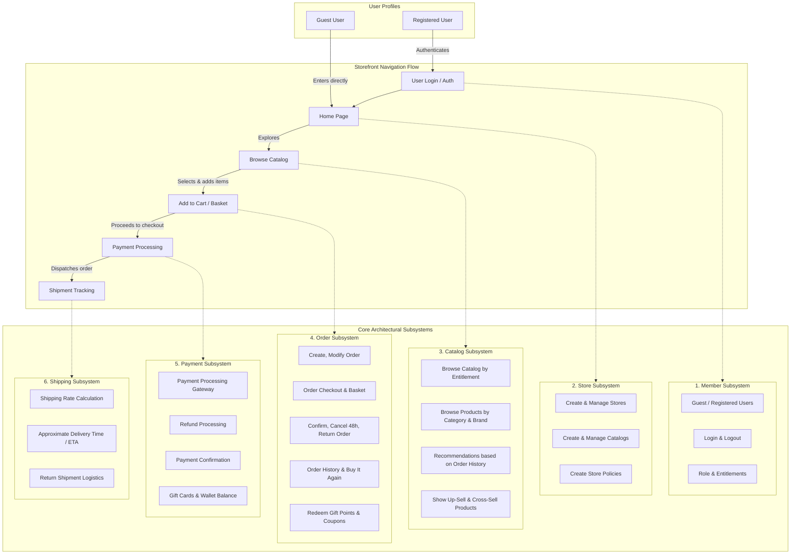
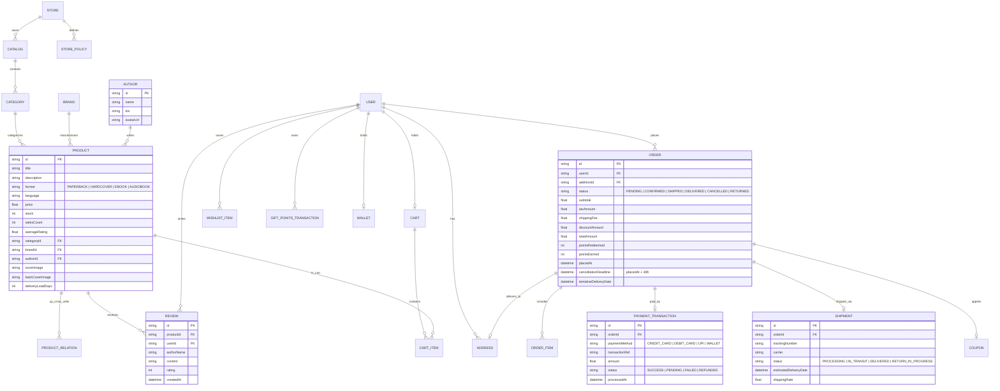

# Online Bookstore Platform — Architecture & Implementation Plan

## 1. Project Overview & Objectives
An enterprise-grade e-commerce bookstore platform ("**Book Worm**") designed to deliver seamless customer journeys for both **Guest Users** and **Registered Members**, backed by 6 modular core subsystems: **Member**, **Store**, **Catalog**, **Order**, **Payment**, and **Shipping**.

---

## 2. Target System Architecture Diagram

---

## 3. Subsystem Breakdown & Capability Matrix

### 1. Member Subsystem
- **Guest / Registered Users**: Anonymous guest cart and checkout vs. persistent authenticated customer profiles saved in PostgreSQL.
- **Login & Logout**: Secure JWT-based session management, simplified for the demo using a **UI Persona Switcher** (allows hot-swapping between pre-seeded DB profiles without real-world OAuth or password resets).
- **Role & Entitlement**: Role-Based Access Control (`GUEST`, `CUSTOMER`, `STORE_ADMIN`, `SYSTEM_ADMIN`) and catalog access entitlements (e.g., VIP discounts, member-only catalogues).

### 2. Store Subsystem
- **Create & Manage Stores**: Store multi-tenancy / store instance configuration (store metadata, currency, locale, contact info).
- **Create & Manage Catalogs**: Association of catalogues to stores and customer segments.
- **Create Store Policies**: Definition of cancellation window (e.g. 48-hour cancellation rule), return window (e.g. 14/30 days), shipping thresholds, and points exchange rates.

### 3. Catalog Subsystem
- **Browse Catalog by Entitlement**: Filters displayed products based on user role / segment entitlements.
- **Browse Products by Category & Brand**: Multi-level category hierarchy (e.g., Fiction, Non-Fiction, Tech) and Brand/Publisher/Author filtering.
- **Recommended Products based on Order History**: Suggestion engine analyzing past purchases and favorite genres.
- **Up-Sell & Cross-Sell Products**: Contextual product bundles (e.g., hardcover edition up-sell, related companion books, bookmarks).

### 4. Order Subsystem
- **Create, Modify Order**: Basket item addition/removal, quantity adjustments, price calculations.
- **Order Checkout**: Multi-step checkout pipeline (address selection, discounts, payment choice).
- **Confirm, Cancel & Return Order**:
  - Instant order confirmation and receipt.
  - **48-Hour Order Cancellation Rule**: Automated validation allowing instant cancellation and full reversal within 48h of order creation.
  - **Return Order**: Return request workflow post-delivery.
- **Order History & "Buy It Again"**: Customer past order tracking with 1-click repopulation of past basket items.
- **Redeem Gift Points & Coupons**: Applying coupon promo codes and redeeming loyalty gift points against the order total.

### 5. Payment Subsystem (Simulated Gateway)
- **Payment Processing using Gateway**: Server-side simulated API gateway validating card parameters (checksums, CVV, dates), UPI formats, or store wallet balances, returning instant status codes and recording transactions in PostgreSQL.
- **Refund Processing**: Automated refund transaction updates in the database when an order is cancelled within 48 hours or when a return is requested.
- **Payment Confirmation**: Secure, immediate payment receipt settlement generation.
- **Gift & Wallet**: Customer wallet balance and gift points ledger ledger management saved in PostgreSQL.

### 6. Shipping Subsystem (Rule-Based Engine)
- **Shipping Rate Calculation**: Deterministic shipping cost calculation based on simple rules (e.g., Standard = Free / Express = ₹50) instead of complex carrier API integrations.
- **Approximate Delivery Time (Tentative Delivery Date)**: Dynamic calculation of estimated delivery dates in the backend relative to current server time (e.g., Standard = `now + 3 days` / Express = `now + 1 day`) displayed on PDP and checkout.
- **Return Shipment**: Return receipt registration and reverse logistics status tracking.

---

## 4. Storefront UI Specifications ("Book Worm")

### 1. Brand Identity & Global Shell (IBM Carbon Design System)
- **Storefront Name**: **"Book Worm"**
- **Design System Framework**: **IBM Carbon Design System (v11)**
- **Theme**: Carbon Dark Mode (**Gray 100 / g100** Theme tokens)
  - **Base Background**: `#161616` (Carbon `$background`)
  - **Card / Layer 01 Surface**: `#262626` (Carbon `$layer-01`)
  - **Secondary / Layer 02 Surface**: `#393939` (Carbon `$layer-02`)
  - **Primary Action Accent**: `#0f62fe` (Carbon `$interactive-01` / Carbon Blue 60)
  - **Interactive Hover**: `#0353e9` (Carbon `$hover-primary`)
  - **Primary Text**: `#f4f4f4` (Carbon `$text-primary`)
  - **Secondary Text**: `#c6c6c6` (Carbon `$text-secondary`)
  - **Muted Helper Text**: `#8d8d8d` (Carbon `$text-helper`)
  - **UI Borders**: `#393939` (Carbon `$border-weak` / `$border-subtle`)
- **Header Navigation** (matching Carbon UI Shell Header):
  - Logo: "Book Worm" icon or typography.
  - Links: `My Orders` (with Buy In Again), `My Wishlist`, `My Writers`.
  - Right: Cart icon with live quantity counter badge, User Account icon.

### 2. Search & Universal Filter Bar
- **Search Input**: Full-text search with placeholder *"Search you want to read here"* & auto-complete.
- **Filter Controls**: `Language` (All, EN, ES, FR, HI, etc.), `Format` (Paperback, Hardcover, eBook, Audiobook), `Price Range`, `Sort by` (Relevance, Price, Rating, Newest).

### 3. Category & Genre Left Sidebar
Vertical active navigation:
`All` · `Romance` · `Mystery` · `Science Fiction` · `Fantasy` · `Historical` · `Biography` · `Self-help` · `Memoir` · `Travel` · `Cooking` · `Children's` · `Young Adult` · `Comics & Graphic Novels` · `Poetry` · `Drama` · `Science` · `Philosophy` · `Religion` · `Language Learning`.

### 4. Product Detail Page (PDP) & Shopping Cart View
- **Breadcrumb Navigation**: e.g. `Home / Non-Fiction / Self Help`.
- **Book Showcase Grid**:
  - **Cover Showcase**: Front Cover image and interactive Back Cover preview card (blurbs, excerpt quote, barcode, author teaser).
  - **Book Summary & Actions Column**:
    - **Title**: e.g., *Joy of Minimalism*.
    - **Author**: `by Daniel Reed` (linked to writer profile).
    - **Tagline**: `Declutter your life to uncover peace, clarity, and joy.`
    - **Publisher/Brand**: `Published by: ABC Publishers` (clickable brand filter).
    - **Format Badge**: `Paperback` / `Hardcover` / `eBook`.
    - **Category Tags**: `Non-fiction`, `Self Help`.
    - **Price**: Localized currency (e.g. `₹149`).
    - **Delivery ETA**: Real-time shipping calculation (e.g. `Delivery by Mon, 21 Jul`).
    - **Action Buttons**:
      * **"Add to Cart"** (Primary blue button with basket icon).
      * **"Add to Wishlist"** (Secondary button with bookmark icon).
    - **Metadata Metrics**:
      * `Language`: `English`
      * `Rating`: `★★★★★` (e.g. 5.0)
      * `Sells`: `145 copies sold` (social proof sales counter)
- **About the Writer Section**:
  - Author photo avatar, Full Name (`Daniel Reed`), and detailed biography narrative.
- **Customer Reviews & Rating Submission**:
  - Interactive "Leave Your Review" form with `0/100` character counter, 5-star rating widget `☆☆☆☆☆`, and `Submit →` button.
  - Review feed showing reviewer name, rating stars, and testimonial text.
- **Right Sidebar — "Related Reads"**:
  - Vertical cross-sell rail recommending related titles based on order history & author affinities (e.g., *The Art of Focus*, *The Art of Learning*, *The Path to Success*).

### 5. Payment & Purchase (Checkout) UI Specification
- **Breadcrumb**: `Home / Non-Fiction / Self Help / Joy of Minimalism / Checkout /`
- **Cart Summary & Quantity Controller**:
  - Multi-item card list (e.g., *Joy of Minimalism* ₹149 + *The Path to Success* ₹359).
  - Interactive quantity stepper `[ - ] <quantity> [ + ]` with automatic grand total recalculation.
- **Delivery Address Section**:
  - `[ ] Use Saved Address` toggle for authenticated members.
  - Input fields: `First Name`, `Last Name`, `Address Line 2`, `e-mail`, `City`, `Pin`, `Phone Number` (with country code `+91`), `State`, `Country` (dropdown selector).
- **Grand Total & Payment Panel**:
  - Book illustration card graphic.
  - Itemized financial breakdown:
    * `Price (X items)`: Sum of item prices.
    * `Tax`: Applicable tax calculation.
    * `Delivery Charges`: `Free` (or calculated rate).
    * `Discount`: Real-time deduction from redeemed Gift Points or promo Coupon.
    * `Total Amount`: Final payable figure.
  - Promo code / Gift points input with **"Apply"** button.
  - Primary CTA: **"Pay Now"** button with card icon triggering payment authorization modal.

### 6. Payment Screen / Modal Dialog Specification
- **Backdrop**: Themed illustrative background with floating book art.
- **Dialog Header**:
  - Title: **"Complete Payment"**
  - Amount: **"Payable Amount: ₹XXX"** (e.g., `₹580` / `₹470`)
- **Payment Method Tabs (Left Navigation)**:
  1. **`Credit Card`** (Default active)
  2. **`Debit card`**
  3. **`UPI`**
  4. **`Wallet`** (Gift Points & Store Wallet balance)
- **Card Form Fields (for Credit / Debit Card options)**:
  - `Card Number`: Formatted card number input (`XXXX-XXXX-XXXX-XXXX`)
  - `Name on Card`: Cardholder full name
  - `CVV`: 3 or 4 digit security code (`XXX`)
  - `Date of Expiry`: Expiration date (`MM/YYYY`)
- **UPI Option**:
  - Virtual Payment Address (VPA) / UPI ID input + dynamic QR code generator.
- **Wallet Option**:
  - Available balance indicator + 1-click authorization.
- **Action Button**:
  - High-contrast blue **"Pay Now"** CTA with credit card icon.

### 7. Purchase Confirmation Modal Specification
- **Status Indicator**: Centered green circular checkmark icon (`✔`).
- **Headline**: **"Your purchase of the following reads is successful"**
- **Purchased Reads Display**:
  - Side-by-side cards highlighting purchased books (*Joy of Minimalism* ₹149, *The Path to Success* ₹359) with format tags, genre badges, price, and tentative delivery date.
- **Primary Action**: Centered blue **"Continue your Shopping"** CTA (returns user to Home / Catalogue).
- **Post-Purchase State Automation**:
  - Shopping cart automatically cleared.
  - Order saved to database with state `CONFIRMED`.
  - 48-Hour cancellation window initialized (`cancellationDeadline = placedAt + 48 hours`).

---

## 5. Technology Stack & Component Architecture

| Layer / Component | Technology Choice | Details & Implementation Notes |
|---|---|---|
| **Database** | **PostgreSQL** | Relational data persistence with ACID transactions for orders, inventory, and points |
| **ORM / Data Access** | **Prisma / Drizzle ORM** | Type-safe migrations, relations, and seed scripts |
| **AI Augmentation on UI** | **IBM BOB (or AWS KIRO)** | Vibe coding with rapid prototyping of pixel-perfect Tailwind/React components based on wireframes |
| **Data Model Design** | **Manual + AI-Assisted** | Relational schema mapped directly from UI wireframes and business constraints |
| **API Specification** | **OpenAPI 3.0 (Swagger)** | Auto-generated OpenAPI JSON/YAML specs with Swagger UI documentation |
| **AI Augmented Backend Services** | **IBM BOB (or AWS KIRO)** | Generation of type-safe RESTful API endpoints and business logic across 6 subsystems |
| **AI Augmented Test Case Generator** | **ICA Agents** | AI agent-driven testing: *Test Scenario Generator*, *API Testcase Generator*, *React Component Test Generator* |
| **Frontend Framework** | **Vite + React SPA** | TypeScript + IBM Carbon Design System (`@carbon/react`) + `@carbon/icons-react` + Tailwind CSS (utility/layout helper classes) + Zustand + Client-side Routing |
| **Local Deployment** | **Docker & Docker Compose** | Multi-container setup (`frontend`, `backend-api`, `postgres`) for one-click local runs |
| **Cloud Deployment** | **AWS ROSA / IBM ROKS** | Containerized microservices deployed to Red Hat OpenShift on AWS (ROSA) or IBM Cloud (ROKS) |
| **Version Control & Collaboration** | **GitHub PR Workflow** | Feature branch development with Pull Requests submitted to personal GitHub with access granted to Manager |

---

## 6. Domain Data Model (Database Schema Overview)

---

## 7. Step-by-Step Implementation Roadmap

### Phase 1: Foundation, PostgreSQL & Subsystem Scaffolding
- [ ] Initialize project structure (Vite + React SPA Frontend & Express/Node.js API Backend).
- [ ] Configure PostgreSQL database connection and Docker Compose environment (`docker-compose.yml`).
- [ ] Configure Dark Mode design tokens, Tailwind CSS, and `@carbon/icons-react` via vibe coding.
- [ ] Set up PostgreSQL Prisma / Drizzle schema with manual domain modeling based on wireframes.
- [ ] Configure OpenAPI 3.0 (Swagger) spec generation tooling.
- [ ] Configure Member subsystem: Auth, Guest session handling, and Role/Entitlements.

### Phase 2: Store & Catalog Subsystems (Discovery & Recommendations)
- [ ] Seed PostgreSQL catalog with books shown in design (e.g., *Joy of Minimalism*, *The Art of Focus*, *The Art of Learning*, *The Path to Success*, etc.) and authors (e.g. Daniel Reed, Arjun Patel, Raj Patel, James Wright).
- [ ] Implement Category Sidebar (20+ genres) and Filter Bar (Language, Format, Price Range, Sort).
- [ ] Implement Home Sections: "Recommended for You", "Bestsellers this Month", and "New Launches".
- [ ] Build Product Detail Page (PDP):
  - Cover gallery with Front and Back Cover views.
  - Book metadata (Language, Rating, Sales count counter).
  - Tentative Delivery Date calculator (Shipping Subsystem integration).
  - Author bio section and interactive Review submission form (`0/100` characters, star rating).
  - "Related Reads" cross-sell sidebar.

### Phase 3: Order Subsystem, Basket & Wishlist
- [ ] Top navigation with live cart badge counter and links (`My Orders`, `My Wishlist`, `My Writers`).
- [ ] Persistent shopping basket for both Guest and Registered users (Add to Cart from PDP and Feed).
- [ ] Wishlist toggle ("Add to Wishlist" action).
- [ ] Quantity stepper controls (`+` / `-`) with live subtotal updates.
- [ ] Order History list with order details, item breakdown, and status badges.
- [ ] "Buy It Again" 1-click basket population logic from Order History.

### Phase 4: Checkout, Coupons, Gift Points & Payment Subsystem
- [ ] Multi-step checkout UI:
  - Shopping cart review panel with live quantity adjustments.
  - Delivery address form (First/Last name, Address line, Email, City, Pin, Phone with +91, State, Country) + Saved Address toggle.
  - Grand total card with breakdown (`Price`, `Tax`, `Delivery Charges`, `Discount`, `Total Amount`).
  - Coupon & Gift Points redemption engine with instant `Apply` calculation.
- [ ] Complete Payment Screen / Modal dialog:
  - Tabbed payment method selector (`Credit Card`, `Debit card`, `UPI`, `Wallet`).
  - Card detail inputs (`Card Number`, `Name on Card`, `CVV`, `Date of Expiry`).
  - Payment gateway transaction processing via "Pay Now" trigger.
  - Purchase Confirmation modal: Green checkmark, purchased books overview, and "Continue your Shopping" button.
  - Post-purchase cart clearance and order persistence.

### Phase 5: Shipping, 48-Hour Order Cancellation & Returns
- [ ] Shipping subsystem: Rate calculation engine & approximate delivery timeline.
- [ ] 48-Hour Order Cancellation Engine:
  - Strict validation (`now <= placedAt + 48 hours` and not shipped).
  - Automatic inventory release, payment refund processing, and points reversal.
  - Order History cancellation action with remaining time display.
- [ ] Return Order workflow: Return shipment tracking and refund settlement.

### Phase 6: AI-Augmented Testing (ICA Agents) & Verification
- [ ] Generate comprehensive test scenarios using **ICA Test Scenario Generator**:
  - End-to-End user journeys: Guest / Registered browsing, checkout, points redemption, 48-hour cancellation.
- [ ] Generate API tests using **ICA API Testcase Generator**:
  - OpenAPI schema conformance tests for all 6 subsystems.
  - Boundary and validation tests for payments, discounts, addresses, and order cancellation.
- [ ] Generate React unit/component tests using **ICA Testcase Generator for React**:
  - PDP reviews, filter controls, cart stepper, and checkout modal interactions.
- [ ] Execute test suites with 100% passing threshold before build approval.

### Phase 7: Deployment (Local & Cloud: AWS ROSA / IBM ROKS) & PR Delivery
- [ ] **Local Machine Readiness**:
  - Containerize application with Dockerfile and `docker-compose.up.yml`.
  - Validate local startup with seeded PostgreSQL database.
- [ ] **Cloud Deployment (AWS ROSA / IBM ROKS)**:
  - Prepare Kubernetes / OpenShift manifests (`Deployment`, `Service`, `Route`/`Ingress`, `ConfigMap`, `Secret`).
  - Deploy to AWS ROSA (Red Hat OpenShift on AWS) or IBM ROKS (Red Hat OpenShift on IBM Cloud).
  - Validate cloud endpoints and health checks.
- [ ] **GitHub PR & Review Workflow**:
  - Push branch to personal GitHub repository.
  - Open a well-structured Pull Request (PR) with feature breakdown and screenshots.
  - Grant repository collaborator access to Manager for PR review and approval.

---

## 8. Agents & Skills Matrix

| Role / Agent / Tool | Specific Function in Project |
|---|---|
| **IBM BOB (or AWS KIRO)** | Primary AI augmented IDE assistant for vibe coding the UI, implementing backend services, creating OpenAPI specs, and managing Git/deployment workflows. |
| **ICA Test Scenario Generator** | AI agent generating complete functional test scenarios across customer journeys. |
| **ICA API Testcase Generator** | AI agent generating automated API integration tests against the OpenAPI specifications. |
| **ICA React Testcase Generator** | AI agent generating component and interaction tests for React/Next.js UI components. |
| **`create-chart`** | Visualizing order history analytics, sales trends, and loyalty points earning/spending charts. |
| **Screenshot / Vision Analysis** | Converting UI mockups and architectural diagrams into pixel-perfect frontend components and backend workflows. |

---

## 9. Requirements & Screenshot Log
- **Batch 1 (Customer Journeys)**: E-Store Home, Catalog Discovery, Checkout & 48h Cancellation.
- **Batch 2 (Architectural Diagram Analysis)**: 6 Subsystems (Member, Store, Catalog, Order, Payment, Shipping).
- **Batch 3 (Storefront UI Mockup — 'Book Worm')**: Dark theme, 20-category sidebar, filter controls, 3 curated home feeds, book cards with delivery dates.
- **Batch 4 (The Catalogue Page Slide)**: Category selection, Brand browsing, Product selection with delivery dates, Related products, Order History "Buy In Again".
- **Batch 5 (Product Detail Page & Shopping Cart Slide)**: PDP layout, Dual covers, author bio, reviews (0/100 char limit), Related Reads sidebar.
- **Batch 6 (Payment & Purchase Slide)**: Cart list with steppers, Delivery address form, Grand Total itemized breakdown.
- **Batch 7 (Payment Screen Modal Slide)**: Complete Payment dialog, Credit/Debit/UPI/Wallet tabs, Card inputs, "Pay Now" action.
- **Batch 8 (Purchase Confirmation Slide)**: Green checkmark, Success headline, purchased reads cards, "Continue your Shopping" button.
- **Batch 9 (Tech Components, AI Agents, Deployment & PR Workflow)**:
  - Database: PostgreSQL.
  - AI augmentation on UI & Backend: Vibe coding with IBM BOB (or AWS KIRO).
  - Data model design: Wireframe-based manual validation.
  - OpenAPI / Swagger spec generation for all subsystems.
  - AI test case generation: ICA Agents (Test Scenario Generator, API Testcase Generator, React Testcase Generator).
  - Deployment: Local (Docker Compose) and Cloud (AWS ROSA / IBM ROKS).
  - Collaboration: GitHub PR workflow with Manager access.
- **Design Reference Mockups (Located in `./Design/` directory)**:
  - **Catalog Page (Browse, Search, Filter & Lists)**: [`Design/CatalogPage.png`](Design/CatalogPage.png)
  - **Product Detail Page (Cover, Summary, Review & Sidebar)**: [`Design/ProductDetailsPage.png`](Design/ProductDetailsPage.png)
  - **Cart & Checkout (Quantity controls, Address Form, Grand Total)**: [`Design/CartPage.png`](Design/CartPage.png)
  - **Payment Modal (Card, UPI & Wallet Options)**: [`Design/PaymentPage.png`](Design/PaymentPage.png)
  - **Purchase Confirmation (Success checklist & Return to Shopping)**: [`Design/ConfirmationPage.png`](Design/ConfirmationPage.png)
